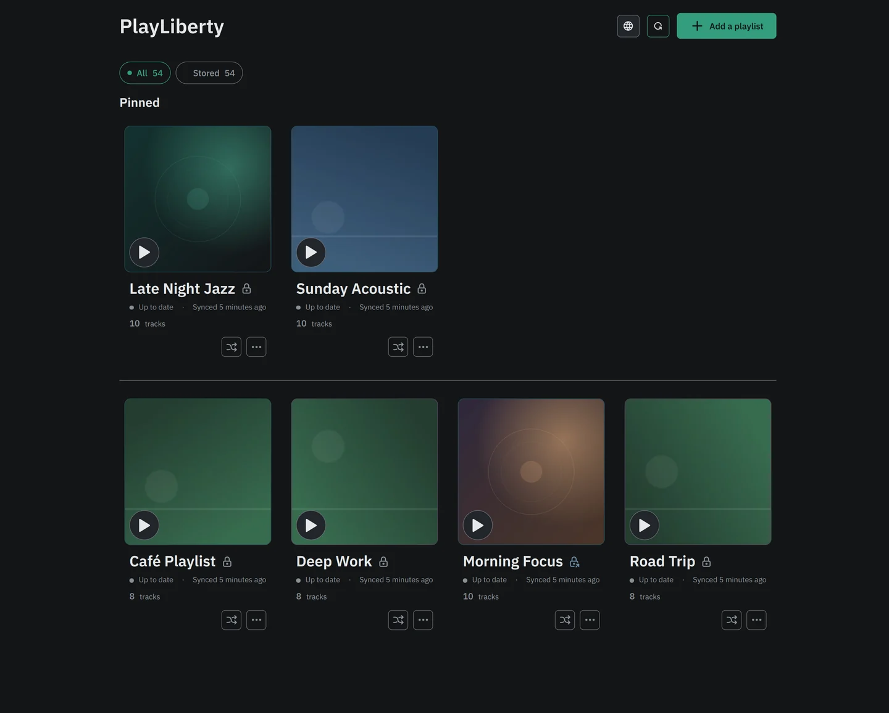
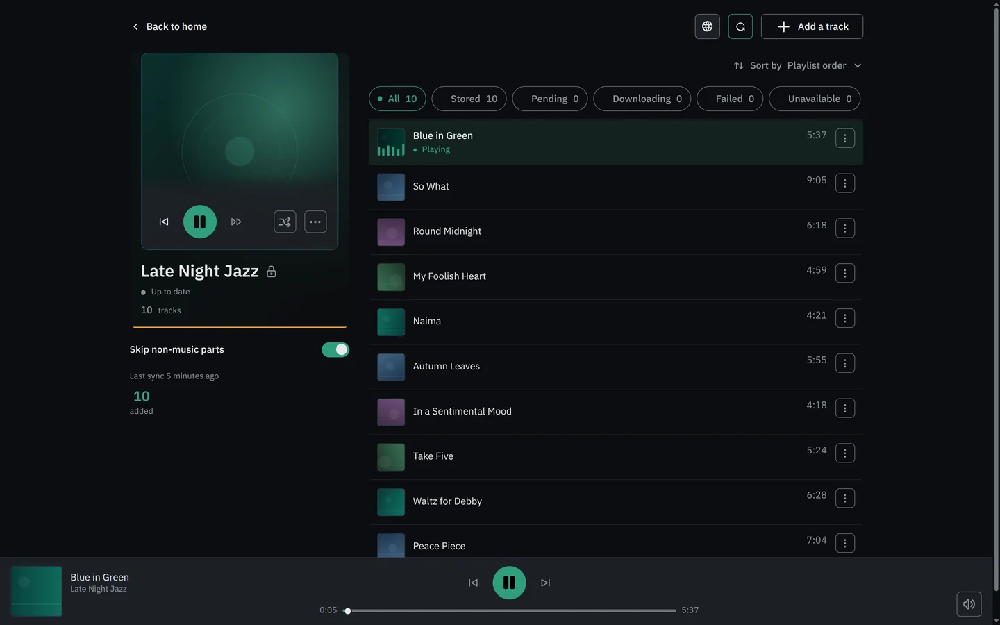
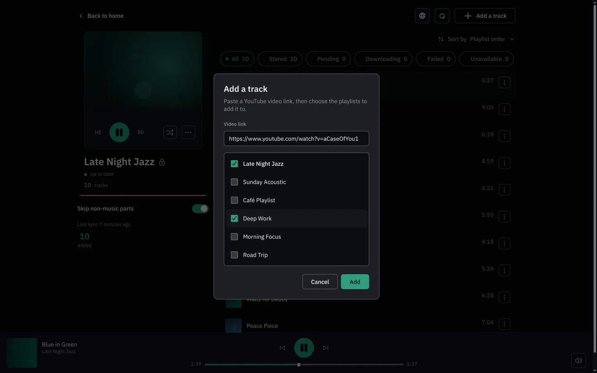
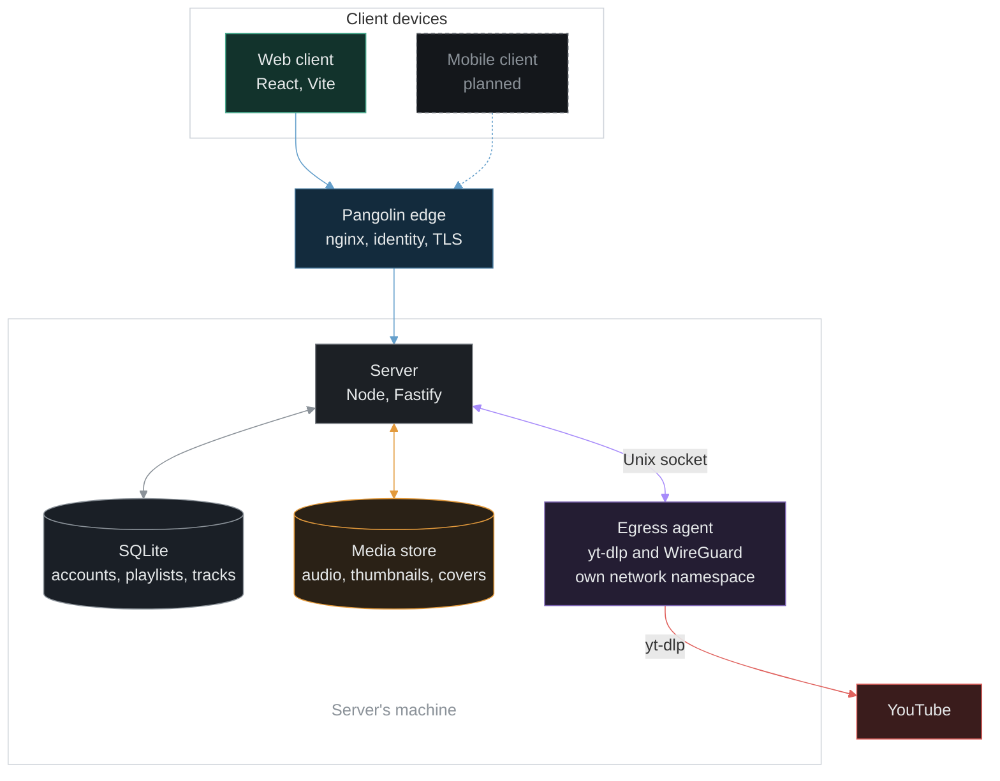

# PlayLiberty

PlayLiberty is a self-hosted audio player for a small private group. It copies the audio of a YouTube playlist into a store that the owner controls. A video removed from YouTube does not remove the track from the playlist.

## Why it exists

A YouTube playlist is a list of links. When a video goes away, the playlist loses the track. A downloaded file keeps one track, but it forgets the playlist and does not stay current.

PlayLiberty keeps the audio and the link to the source playlist. A sync adds new tracks and keeps the tracks whose source video is gone. Playback reads the stored file, not YouTube.

## What the app does

- Imports a YouTube playlist or a single video.
- Syncs a playlist on demand. A removed video keeps its stored track.
- Streams the stored audio to the web client.
- Holds several accounts on one instance. A playlist owner shares a playlist read-only or read-write with named accounts.
- Adds one pasted video to several write-accessible playlists in one action.
- Pins playlists, and sets, crops or removes a custom cover.
- Removes tracks with no playlist in a weekly job.

The screenshots use a demo instance with sample playlists and tracks.

## The components

**Web client.** A React 19 single-page application built with Vite. It draws the gallery, the playlist detail, the player and the operator's egress page. It reaches the server only through `/api/v1`.

**Server.** A Node 26 process built with Fastify 5. It owns accounts, playlists, the SQLite database, the media store, sync, streaming and the weekly prune. The download worker runs in the same process.

**Egress agent.** YouTube rate-limits or blocks an address that it sees as automated or overused. A blocked address cannot list a playlist or fetch a track, and a home connection can reach that state after many downloads. The agent gives the server a pool of WireGuard exits and sends the YouTube traffic through the active one. When YouTube refuses an exit, the server rotates to another address in the pool.

The agent runs on the host, in its own network namespace. It switches exits, measures which exit reaches YouTube, and reports the facts. The server owns the rotation policy and the stored result. The agent holds no database and no policy, and the server's other traffic never enters the tunnel.

**Edge.** Pangolin authenticates every request and injects the user identity. nginx serves the web client and proxies `/api` to the server. The server publishes no host port.

**Mobile client (planned).** An Expo application that uses the same API with a per-user Pangolin token.
